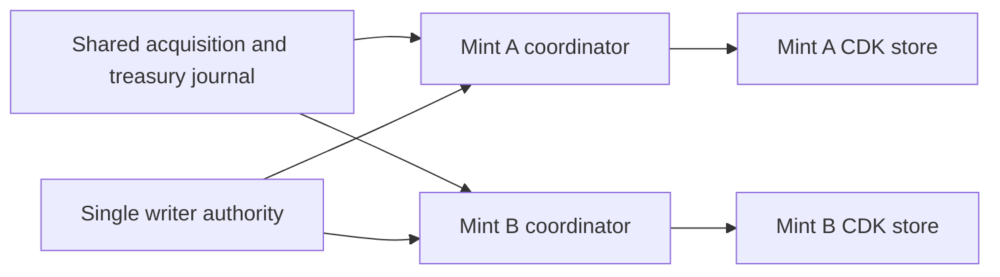

# Cashu wallet and core boundary

Implementation checkpoint: 2026-11-16, isolated source only. The
[implementation plan](../planning/cashu-nutnovember-implementation-plan.md) remains
the full scope. These modules are not an installed wallet service, enabled
payment rail, live-qualified treasury path, or production authorization.

The wallet package under `tools/cashu-compat` keeps CDK and its SQLite adapter
outside the core dependency graph. The core and wallet share the bounded receipt
schema in `crates/cashu-receipt` and the existing Nostr event verifier through
`crates/nostr-event`. The wallet-to-core projection contains no spendable proofs.

Both ordinary private Cashu and signed NIP-61 intake use the same validation,
canonical mint/unit/Y proof index and acquisition journal. Only independently
verified owned outputs can produce an acquired receipt. A mint reporting spent
inputs, a completed CDK saga, or a wallet balance alone cannot authorize credit.
The actual-CDK protocol fault fixtures remain distinct from independent sender,
mint, phone scan, or live provider qualification.

## Receipt import

`src/cashu/receipt_authority.rs` authenticates kernel Unix-socket credentials
before receipt parsing. Root, the core's own UID and unregistered wallet UIDs
cannot import receipts. Protected policy binds the wallet instance, wallet epoch,
core epoch, approved mint/policy pairs, per-receipt amounts and separate core
exposure/rate limits. Zero limits grant no permission.

`src/ledger/cashu.rs` performs exact replay lookup, clock/rate/custody checks,
private provenance insertion, positive credit, existing cap retirement and one
`payment_received` event in one immediate SQLite transaction. Exact retries return
the original acknowledgment even after credit retirement or disabling new import.
Changed immutable data fails. Above-cap value remains wallet custody; retiring
feeder credit does not remove acquired ecash or release custody exposure.

Cashu receipts are not `settled_payments`, native BTC `credit_grants`, NIP-57 zap
receipts or CyberHerd membership. Their source proof is `unavailable` for existing
Strike payout authorization. The public event exposes only the transport marker,
net contribution, shared progress and `herd` identity/pool. Mint and wallet
operation evidence remain private.

The source runtime now wires the authenticated core receipt server, protected
registration, public ordinary-token forwarding, wallet relay/acquisition workers
and durable receipt delivery. A separate-UID receipt fixture verifies exact retry
after a lost acknowledgment. This does not establish an installed service,
independent sender interoperability or the complete public HTTP-to-wallet path;
those acceptance requirements remain open.

## Physical source selection

Source funding history must be initialized explicitly. Receipt import refuses to
initialize or reinterpret paid history implicitly. The existing source-lot audit
substrate is reused without enabling reward policy or payout execution.

Once Cashu receipts exist, aggregate credit alone cannot create a physical
attempt. A separate financial plan freezes exact credit parts before conversion.
Only one pending financial plan exists; it has no physical request UUID and does
not occupy the gateway's unresolved-actuation slot. `feed_sources.rs` and its
financial adapter select at most 4096 source lots. A ready plan freezes those same
parts into the physical request; confirmation debits, reward evidence and message
attribution use that allocation. Ambiguous physical outcomes keep their original
UUID and reservations.

Unconverted Cashu can wait without blocking later settled-only funding. If later
settled lots can fund the threshold, the transaction records the old plan's
explicit release, creates the replacement and links the supersession. It does
not erase or repeat any treasury operation. Threshold changes have their own
release disposition. Offline retirement refuses lots held by a pending financial
plan. The protected `lightning-goatsctl release-financial-plan` command checks
the original plan, threshold and ledger epoch with the core writer stopped. It
releases only the undispatched feeding allocation. Treasury holds have their
own recovery requirements.

Automatic treasury planning reserves the uncovered Cashu portion of the pending
plan in the same transaction as its treasury link. Age/balance sweeps and stable-ID
operator sweep requests share the same custody reservation and global/per-mint
fee, daily-input and unresolved-exposure limits. Least-recent mint admission
prevents an eligible first mint from continually taking every slot. Age currently
means time since core receipt acceptance; it does not measure unimported wallet
holdings. All new execution controls default off.

The core creates a purpose-bound Strike invoice. The wallet's original-operation
melt report and independently fetched Strike receipt must agree before completion
qualifies the assigned Cashu input for feeding. In schema 29, 1,000 sats of
original contribution credit start the sequence. Once the assigned inputs have
settled, fees and returned change cannot create a shortfall for that feed.
Returned change remains in wallet custody for a later batch. At physical
confirmation the core records the native Lightning sats and the share of each
actual Strike deposit attributable to the consumed contributions. CyberHerd
uses that net amount as its payout base. A later sweep of change creates no
additional contribution. [CyberHerd reward funding](cyberherd-reward-funding.md#net-cashu-proceeds-for-confirmed-feeds)

The [financial-plan checkpoint](../testing/cashu-financial-jobs-20261116.json)
and [sweep checkpoint](../testing/cashu-sweeps-20261116.json) qualify these core
invariants with synthetic fixtures. The [combined actual-CDK/core fixture](../testing/cashu-combined-settlement-20261116.json)
now verifies the zero-fee 600 Lightning + 250 nutzap + 150 ordinary Cashu case:
original wallet acquisition receipts, automatic financial planning, one melt,
independent mocked Strike receipt, no transfer-as-donation, replay after credit
consumption and one simulated ledger confirmation. This joins components through
private fixture files; distinct-UID socket boundaries have separate tests.
Combined nonzero-fee/change and lost-response coverage, full transport,
independent-client and live acceptance remain separate. None authorizes feeding.

## Schema and maintenance

The uninstalled migration-26 draft adds private receipt/clock, custody and
treasury-operation tables, financial plans/supersessions, sweep records and frozen
physical-source tables. It does not rewrite historical paid, signed, feeder or
reward rows. The separate
`snapshot-before-cashu`, `verify-cashu-upgrade-source` and `compare-cashu-upgrade`
maintenance commands describe an exact schema-25 source and an already migrated,
inactive schema-26 copy. They do not apply a live migration or resume services.

Historical contact, feeder-cap and inclusive-fee comparisons retain their exact
schema-25 target contracts. Their existing deployment automation must not be used
to install the schema-26 Cashu candidate without a qualified upgrade chain. That
deployment integration remains open.

Ordinary current-schema maintenance now expects schema 26. Four-journal
verification explicitly refuses Cashu-bearing core state because it cannot prove
wallet/core conservation or include wallet secrets and pending operations. The
required coordinated wallet/core archive and restore fencing remain open. A seed
or four-journal backup alone is not a complete Cashu backup.

## Reading the detailed implementation notes

The sections below retain the order in which adapters and recovery boundaries
were introduced. Their dated, slice-specific statements about work still pending
are historical checkpoints, not the current completion checklist. The current
architecture above and [implementation status](../implementation-status.md)
distinguish fixture-qualified source from remaining integration and installed
acceptance. The full [implementation plan](../planning/cashu-nutnovember-implementation-plan.md)
continues to define completion; no checkpoint narrows that scope.

## Deterministic treasury source allocation

The private treasury contract allocates the independently verified deposit to
frozen ledger sources in ascending order, then actual conversion fees, with
remaining value retained as source-attributed change. Every source and the whole
operation must conserve value. A report with balanced totals but a different
source assignment is rejected: otherwise it could move feeding coverage or
future reward provenance between donors. The wallet must use this same allocator
after ownership reconciliation; arithmetic alone proves neither payment nor
change ownership. Wallet melt execution is now implemented and qualified with
synthetic protocol fixtures; live provider and complete composed-flow acceptance
remain separate.

The wallet's `MeltDerivation::capture` validates CDK's pre-POST `MeltRequested`
saga against the exact BOLT11 melt request: original operation/quote, bounded
unique input Ys, checked deposit/input-fee/change conservation, final proof IDs,
change outputs and derivation counters. Blank change outputs are recomputed from
the wallet seed and keyset; an arbitrary caller-selected change destination fails.
Zero-change requests require no outputs. This is recovery-material validation,
not payment evidence or submission authority. The transport must still bind and
persist this material with the original treasury operation before permitting a
melt POST; paid/change reconciliation remains separate work.

`Journal::freeze_treasury_melt_request` now atomically retains the canonical
private request and validated change derivation under the prepared treasury
intent. It rechecks original operation/quote/mint, exact reserved input Ys,
signatures and amounts, and wallet-derived change. The first freeze requires an
unexpired invoice/quote; later exact comparison is allowed after expiry without
permission to resend. Changed request bytes or derivation fail. This journal
record does not advance the operation to submitted, expose secrets in receipts,
or grant network authority. Transport wiring and ambiguous-outcome reconciliation
remain required before execution.

The treasury journal now has an atomic submission-claim transition. It accepts
only the original frozen request at its exact mint BOLT11 melt URL while the
invoice and quote remain unexpired, and changes `prepared` to `submitted` before
network I/O. A second claim fails, including after restart and with identical
bytes. `submitted` means an attempt may have happened, never that payment is
confirmed. A crash between the commit and network call is intentionally ambiguous
and must reconcile the original quote. This transition is not yet wired into the
transport; no melt network permission is enabled by this source checkpoint.

Before submission, `verify_melt_inputs` validates each exact input's DLEQ against
pinned mint/keyset/denomination keys and requires a complete, duplicate-free fresh
NUT-07 response identifying every input as unspent. Missing DLEQ, forged proofs,
unknown keys and pending/spent inputs fail. The caller must obtain that response
through the trusted mint transport immediately before claiming submission; this
helper cannot establish response freshness on its own. Durable reservations,
original invoice scope and change-derivation validation are still required.

The CDK operation gate now has an explicit treasury policy and arm operation,
sharing the same process writer lease as acquisition. With that policy installed
and an intent armed, the BOLT11 melt POST path finds the original CDK saga,
fetches current input states from the same mint, verifies pinned-key DLEQ and
unspent inputs, freezes the actual request/change derivation, and commits the
single submission claim before forwarding. The default gate has no treasury
policy and refuses melts. This adapter is not yet configured by a service or
exposed through IPC. Quote creation, durable response retention, recovery/change
accounting and independent provider confirmation remain incomplete.

The melt transport now retains the bounded initial JSON reply atomically before
returning it to CDK. Only an already submitted operation can retain that reply;
exact repeats are harmless and conflicting replacement bytes fail. Later quote
state observations must use a separate reconciliation path rather than overwrite
the initial response. This private evidence does not authorize a deposit, credit,
proof release or change ownership. A transport/storage failure leaves the original
submission claim unresolved, so a new payment attempt remains prohibited.

`melt_reconciliation::validate_paid_quote` checks a paid BOLT11 observation
against the retained signed mainnet invoice, its exact deposit/hash and original
quote ID/amount/fee reserve/expiry/method. The required 32-byte preimage must hash
to the original payment hash. Optional invoice/unit echoes, when supplied, must
match; late observations remain valid after invoice expiry. This is only mint
payment evidence. It neither exports a settlement report nor verifies recovered
change or the independent Strike deposit, and it does not release proof holds.

`verify_owned_change` checks complete ordered change signatures against the
original frozen blank outputs recomputed from the wallet seed. Each returned
proof must match its derived secret, mint/unit/keyset/amount, unblinded mint
signature, blinding factor and pinned-key DLEQ, and have fresh unspent state.
Counts, duplicate states, derivation bounds and total input-value bounds are
checked. The caller must establish completeness of the original response or
restoration result: missing/ambiguous change is not an empty result. This helper
does not yet persist change attribution or produce the terminal settlement report.

Wallet reconciliation now atomically commits the immutable private MeltData
report, original paid evidence, verified change output identities and reconciled
state. It calculates fees by checked conservation, enforces both intent authority
and original input-fee/quote-reserve bounds, and uses the shared deterministic
source allocator. An omitted change response requires restoration rather than
being treated as zero. Change outputs cannot also belong to an acquisition or
another treasury intent; acquisition completion checks the reverse collision.
Source/proof holds are retained. Read-only report replay survives restart without
rechecking already-moved change. Core authentication and independent Strike
confirmation remain required; change reuse/splitting and recovery orchestration
are not yet implemented.

`treasury_recovery_context` loads submitted or reconciled operations without a
new-payment expiry check. Bounded journal records must agree on the original
invoice/deposit, mint, sat/BOLT11 quote and CDK operation identity. The context
exposes no input proof secrets and constructs only the original constrained
quote-status GET URL. Reopening an old operation does not create an invoice,
claim submission again, release holds or produce new credit. Transport polling
and recovery scheduling remain to be connected.

`RecoveryContext::poll_paid` performs one original quote-status GET through the
constrained transport. It checks quote terms for all states, validates paid
preimages, and returns unresolved for nonpaid observations without releasing any
holds or authorizing a replacement. Conflicting quote terms or nonpaid responses
carrying paid evidence fail. It remains usable after expiry and needs no armed
execution lease. Recovery scheduling, missing-change restoration and the final
coordinator integration remain outstanding.

Missing-change recovery now validates the original paid quote and issues a NUT-09
restore request containing only its frozen blank outputs. Response normalization
binds each signature to a requested output/keyset, accepts zero or signed-amount
echoes, restores original ordering, and rejects duplicates, unrelated outputs,
count mismatches and gaps in the NUT-08 output prefix. The raw response remains
separate evidence and does not become a wallet report merely by matching IDs.
Cryptographic proof reconstruction, fresh states, durable restoration evidence
and coordinator integration are still required before terminal accounting.

Restoration evidence is now journaled separately as the original paid observation
plus the bounded NUT-09 response. Both must match the original recovery context;
exact replays compare immutable bytes and conflicting replacements fail. When
paid evidence omits change, terminal accounting requires this retained restoration
record and normalizes it before verifying owned change. The report evidence digest
covers the original paid response and raw restoration independently, rather than
rewriting the mint's paid response to pretend it included change. Recording this
evidence alone never releases reservations or completes settlement.

Restored change can now be reconstructed from the original wallet-derived blank
outputs and normalized signatures. Reconstruction enforces derivation/count/value
bounds, unblinds with pinned denomination keys, and verifies signature DLEQ before
returning candidate wallet proofs. Candidate local state is not fresh mint state:
callers must fetch exact NUT-07 results and verify owned change before durable
accounting. No candidate proof is automatically persisted or exported by this
helper. The remaining coordinator must serialize restoration, wallet persistence,
fresh state checks and terminal journal accounting across restarts.

A serialized treasury recovery coordinator now ties the original journal context,
quote polling, retained/new restoration evidence, proof reconstruction, fresh
state checks, CDK persistence and atomic wallet report together. It acquires the
same writer operation lease as acquisition/melt execution, but exposes no invoice
creation or melt submission method. Pending observations and failures retain the
original claim/holds. Existing change proofs must match exactly and remain
available; recovery preserves their existing metadata instead of overwriting it.
A crash after CDK proof persistence but before report commit leaves the original
operation available for reconciliation. Completed reports replay locally without
mint contact. Service scheduling, nonzero crash-window qualification and source
allocation for reuse of recovered change remain incomplete.

Verified change now has durable per-acquisition parts in addition to output
identity. Sorted output Ys are assigned deterministically against the report's
already frozen per-source change amounts; one denomination may span several
sources. The allocation rejects duplicate/unsorted outputs, excess value and
missing value, and commits with the report/change outputs. This preserves donor
provenance for future reuse without issuing another receipt or credit. Existing
proof holds remain unchanged; reservation/selection of recovered change and
partial-denomination splitting still require implementation.

Wallet source-value reservations now subtract only the verified change returned
by completed wallet reports; unresolved intents continue to hold their full input
value. Proof selection reads both acquired outputs and recovered-change parts.
A shared proof may be listed by its contributing sources within one intent, but
its unique full value must equal the total selected source value, preventing a
partial owner from spending another source's portion. Mint/Y holds remain global
and permanent for spent inputs. Prepared/final request validation uses the same
combined output inventory. These are unreleased wallet-schema changes; existing
production state is untouched and migration qualification remains required.

Treasury quote creation now passes through the same exclusive writer gate. It
requires the original bound invoice, qualified mint, sat unit, no alternate melt
options, and fully reserved source proofs. The journal commits a unique attempt
before the HTTP request and retains the reply before accepting its terms. A
missing reply or invalid quote does not grant melt authority and cannot cause a
second quote creation, including after journal reopen or invoice expiry. Valid
terms are bound before CDK receives the response and persists its own quote.
Retained quote adoption now revalidates the original request, destination and
reply and binds the same terms. The quote request records its exact endpoint,
so a changed configured mint URL cannot reinterpret an older reply. A recovery
coordinator serializes adoption and CDK persistence under the shared writer
lease without contacting the mint. It refuses to overwrite an advanced or
conflicting CDK quote and cannot rewind a prepared/submitted journal operation.
A newly adopted quote must still be unexpired; an already bound quote can replay
locally after expiry, without granting execution authority. A missing reply
remains unresolved. Service scheduling and operator handling of missing replies
remain incomplete.

An explicit treasury executor now constructs CDK with the bound treasury gate
and provides quote creation and direct submission for already reserved intents.
Submission acquires the shared writer lease, commits a unique preparation claim
before CDK can reserve proofs/create a saga, loads the exact held output IDs,
binds CDK's prepared operation and confirms with `skip_swap`. It cannot silently
replace proof provenance through an implicit swap. Transport completion alone
is not verified settlement; the original recovery coordinator and independent
core Strike verification remain necessary. Errors/cancellation retain claims.
Recovery of incomplete CDK preparation failures, partial-denomination splitting,
and service scheduling remain incomplete. The
executor is not installed or connected to a production spending toggle.

Treasury execution can now persist preparation separately and resume its
original CDK operation. Resume requires a fresh original invoice/quote, the
prepared journal state, no frozen melt request, and the exact held proof set.
CDK must still report `ProofsReserved`, with no derivation/request advancement,
and the quote and every reserved proof must belong to the original operation.
The pinned CDK public `confirm_prepared_melt_with_options` entry point restores
that same saga with direct proofs and `skip_swap`; its optimistic-state checks
and the existing final-request gate still apply. No fresh preparation or quote
is created. Submitted, frozen, advanced or conflicting state stays recovery-only.
Initial preparation and resume both validate the entire database proof response
before CDK mutation: the returned set must exactly equal the unique held IDs,
each stored ID must match the actual proof secret, and each row must have the
expected mint, sat unit, state and operation ownership. Initial preparation
requires no existing operation owner even if the row is labelled unspent.
Duplicate/missing/substituted rows or stale ownership retain the original claim
and cannot authorize submission.

Preparation assigns and retains the operation UUID with the journal claim before
any CDK reservation. Under the writer lease, recovery checks that UUID against
the original quote and proof holds. Historical claims resolve the operation
from an existing CDK quote owner. An exact reservation can be bound with
execution paused. With execution enabled, recovery can complete the original
quote and proof reservations under the retained operation. The wallet uses locally retained
mint-scoped fees and the original budget, and can recreate a missing
`ProofsReserved` saga under that same UUID. The owned-output validator checks
the source allocation before recovery mutates the CDK store. Melt submission
remains a separately scheduled step that uses that operation and the original
quote. Partial ownership, an absent operation identity, expired terms, or an advanced
or conflicting saga leave the claim held.

Whole-proof treasury selection now derives its candidates from journaled owned
outputs and their source attribution, rather than caller-supplied IDs. It
requires the already-reserved core source amounts, excludes globally held
proofs, and includes a shared change proof only when all its source parts belong
to that instruction. A deterministic largest-value/lexical-ID search finds an
exact per-source subset under the configured proof bound and a 32,768-node work
budget. It never rounds, overdraws or silently drops source value. The existing
atomic reservation validator checks the chosen set again before freezing it;
restart replay returns that same selection, including after invoice expiry,
without authorizing a new quote or submission. No solution or budget exhaustion
retains source holds and makes no proof reservation. Automatic denomination
splitting and service-level scheduling are still required for the full workflow.

Private receiving now has a shared versioned frame contract and a wallet-side
single-connection handler. The handler checks kernel peer credentials before
reading the length prefix, rejects root/same-UID/unconfigured peers, bounds the
frame allocation and I/O deadline, and validates wallet registration/epoch before
payload processing. Only ordinary Cashu and nutzap payloads are representable;
there are no spend, destination, signer or physical commands on this interface.
Both paths use the established proof/event validators and the same journal
admission identity. Replies contain delivery/acquisition IDs and an admission
status, not spendable outputs, balances or proof of credit. Errors at the socket
boundary are redacted. The process writer lock must remain held by the service.

This is a connection handler, not an installed daemon or public endpoint. The
bounded accept loop, protected socket provisioning, distinct-UID positive
integration test, core forwarding, worker scheduling and receipt acknowledgment
transport are still required. The ordinary HTTP source reference is derived from
the private delivery UUID; changing that UUID cannot bypass proof deduplication.
The receiving toggles do not affect separate original-operation recovery APIs.

The private intake listener now reuses `src/private_ipc.rs` directly through a
repo-relative Rust module path, keeping canonical socket ownership, permissions,
active/stale checks and unexpected-file preservation shared with the existing
services. This remains a repository build, not a separately packaged/published
wallet crate. The only additional direct dependency is the already locked hex
0.4.3 used by that shared module. No core IPC behavior was changed.

The listener validates registration and epoch before binding, processes one
connection at a time, and imposes an explicit 1–64 connections/second budget and
bounded request deadline. Rejected peers/requests close their connection without
ending the accept loop. Shutdown cancels a pending connection and leaves a socket
that only the protected stale-owner check can replace. Standalone daemon/config
wiring and positive distinct-UID request qualification still remain outstanding.

The core now has a bounded forwarding adapter for the same private intake
contract. Protected policy fixes the wallet UID/socket/registration, separate
ordinary/nutzap receive toggles, body bound, concurrency limit and deadline.
Over-capacity requests fail immediately instead of waiting in an unbounded queue.
The adapter verifies the socket peer before writing any frame, bounds escaped
JSON before connection, and accepts only a bounded reply matching the delivery
UUID with a nonempty acquisition ID. This is an admission acknowledgment only;
no ledger import, celebration, feeder credit or treasury spending follows from
it. Public HTTP/relay routing and configuration wiring remain separate work.

The core HTTP router now exposes an optional NUT-18 delivery path at
`/api/v1/cashu`. Without a configured, enabled ordinary-Cashu forwarder, POST and
preflight return 404. Enabled delivery accepts bounded JSON objects via POST,
rejects query parameters and unsupported content types, and forwards only the
ordinary-Cashu payload variant. Wallet admission returns HTTP 202 with a coarse
`accepted` status; it does not report acquired value or credited sats. Unavailable
or refused wallet delivery returns a redacted 503. Bodies are never echoed.

Shared journal admission also applies durable backpressure: at most 1024
uncredited acquisitions and 16 MiB of their serialized input proofs may be
retained before new work is refused. Held and exhausted operations count;
restarting or disabling acquisition does not reset these bounds. The check and
all proof/context/source inserts share one immediate SQLite transaction. Exact
proof-set retries bypass this new-work budget and retain their acquisition ID.
Each acquisition retains at most 64 transport/source aliases, with retries of
already recorded aliases still allowed at that bound. Refusal is temporary
unavailability (HTTP 503), never a claim that a mint has rejected or paid tokens.
Credited history and proof claims remain retained; these queue limits are not a
total database quota or a permission to delete unresolved financial state.

HTTP delivery uses a domain-separated SHA-256 digest of the bounded, exact
request body to form a private version-8 delivery UUID. Repeating identical
bytes therefore retains the original delivery binding, even when every earlier
HTTP reply was lost. Distinct token bodies still reach shared proof-set
deduplication; reusable descriptors are never used as donation identity.
This delivery ID is neither published nor a receipt-status capability.

Browser senders receive wildcard-origin CORS with only POST/OPTIONS and the
content-type header permitted; credentials are not enabled. All route responses,
including body-limit rejections, are no-store with no-referrer. This endpoint has
no ambient-cookie authorization: the token itself is the private delivery data.
The receive example contains only a commented, disabled registration section.
Mint selection, wallet provisioning, WAF/body-log exclusions and independent
client qualification are still required before activation.

NUT-18 HTTP payload requirements were rechecked on 2026-11-16 at
<https://cashubtc.github.io/nuts/18/>. That page specifies POST delivery but no
success-response schema. Pinned CDK 0.18.3's `wallet/payment_request.rs` accepts
any successful HTTP status. The 202 admission response is therefore an application
choice compatible with that inspected client path, not a universal-wallet claim.

Wallet startup configuration now has a bounded, strict JSON decoder and a
protected-file loader using the canonical root-owned configuration checks.
Offline validation opens no journal, wallet database, listener or mint connection.
It validates separate runtime/core UIDs, IPC group, wallet registration, private
state versus socket locations, intake resource bounds, descriptor inventory,
configured mint identities and pinned keyset evidence. Enabling either receiving
rail requires qualified mints with pinned keys; ordinary receiving also requires
an accepted descriptor. Both toggles default off. The Cashu receiving public key
must differ from the configured project Nostr recipient identity. Runtime UID
and private-state ownership checks are separate from offline configuration checks.
Configuration assembles intake policy and now exposes a separate startup-only
key loader; worker scheduling and the standalone daemon entry point remain
unfinished.

Startup key loading reads existing `wallet-seed.bin` (64 raw bytes) and
`receiving-key.bin` (32 raw bytes) inside the canonical, runtime-owned private
state directory. It never generates missing keys or creates files. Open handles
must identify regular, singly linked files owned by the runtime UID, with no
group/world permissions and exact lengths. Symlink opens are refused; nonblocking
open prevents a substituted FIFO from hanging startup. The receiving secret must
parse as a valid scalar and derive the public key pinned in protected config.
The seed and temporary raw secret buffers use `Zeroizing`; this does not promise
that copies inside CDK or the operating system are erased. Key material is not
formatted for logs. Offline config validation still needs no private keys.
Production key provisioning, historical-key retention, coordinated backup and
restore qualification remain separate unfinished requirements.

Wallet runtime assembly now separates `Runtime::initialize` (an explicit local
provisioning operation) from `Runtime::open` (normal restart). Both validate
configuration, runtime identity and provisioned keys before opening databases,
and retain the process writer lock. Initialization requires neither database nor
any SQLite WAL/SHM/rollback sidecar to exist; restart requires both nonempty
regular database files. A partial initialization is retained for reconciliation,
not automatically retried as an empty wallet.

The acquisition journal stores an immutable wallet-instance/key binding. The
binding hashes a versioned domain, the provisioned 64-byte seed, and receiving
public key; it contains no raw key material and is not a public API. Normal
startup verifies it and the existing wallet epoch before opening CDK storage.
Existing journals without a registration require an explicit migration/recovery
procedure; startup cannot adopt them implicitly. This detects changed instance,
seed and receiving identity, but is not a coordinated snapshot-generation or
anti-rollback proof for the two databases. Those backup/restore gates remain open.
`serve_intake` connects the assembled state to the existing bounded private
listener. No daemon CLI, acquisition scheduling, receipt delivery, or production
activation is implied by this library assembly.

A serialized acquisition scheduler now joins private intake through
`Runtime::serve`. Its protected `execution` object defaults acquisition,
reconciliation and exact original-swap replay off, with zero attempts and zero
receive-fee authority. Enabling acquisition or reconciliation requires a positive
explicit attempt budget (bounded at 10,000); replay additionally requires
reconciliation permission. These controls are independent of new-intake toggles.
Configured, qualified mints remain available for recovery after new intake is
disabled; removing their configuration does not erase pending operations.

Each scheduler tick transactionally selects one due validated/prepared/acquiring
receipt and charges its attempt before external work. Durable exponential backoff
starts at five seconds and caps at one hour, with the configured operation
deadline added to the next-attempt time. The attempt budget survives restarts and
never releases proofs when exhausted. Due work is ordered by next-attempt time
then journal order, so an unresolved oldest item is not selected on every tick.
Held, acquired and credited records are excluded from acquisition scheduling;
receipt export is a separate unfinished delivery worker. Missing mint policy
retains work without contacting an unconfigured endpoint. A coarse tick outcome
contains no token data or mint error body.

The worker runs one operation at a time with a whole-operation deadline and a
one-second delay between ticks. Existing coordinator and mint gates retain exact
operation/request authority. Only validated state can enter new acquisition;
prepared/acquiring states reconcile or, when explicitly permitted, recover the
original swap. Timeout and shutdown preserve the charged attempt and original
journal; they never authorize a replacement operation. The existing coordinator
also refuses a new receive when CDK has unresolved mint work. Storage errors in
claim selection stop the worker; operation errors leave the original work for
bounded later reconciliation. A crash before the acquisition hook may still
need explicit CDK/journal reconciliation, rather than a fresh attempt.

After CDK compensates a definitively rejected receive, its removed saga no
longer makes the mint unavailable to independent input proofs. The acquisition
gate now holds the process writer lease while checking that CDK has no unfinished
work, every other unresolved acquisition has retained derivation material, and
the mint store's durable keyset counters cover all of those output ranges.
Capturing a new request additionally refuses overlap with retained recovery
ranges. Failure or cancellation releases only the process lease. Original
requests, proof claims, derivations and recovery states remain intact and never
become credits based on a rejection. Missing material, rolled-back counters and
unfinished CDK work continue to require reconciliation.

This adds a library service loop, not an installed daemon. CLI/systemd wiring,
status for exhausted work, positive network-level scheduler qualification,
receipt delivery, and coordinated restore remain outstanding.

The separate workspace now builds `lightning-goats-cashud`. Its command surface
is deliberately explicit: `check-config <path>` validates protected configuration
without keys/state, `initialize <path>` provisions only empty databases using
existing keys, and `run <path>` opens registered state and runs private intake
plus configured acquisition/recovery. No argument or an unknown command fails;
there is no default runtime action. Errors use fixed coarse messages and do not
echo the config path, parsed data, token material or underlying mint errors.
The existing offline compatibility binary remains Cargo's default run target.

The daemon registers SIGTERM and SIGINT before opening runtime state. Shutdown
cancels the library service future, preserving durable attempt/operation records;
normal process exit closes listeners and releases the writer lock. The owned
stale socket is handled by the existing protected bind helper on restart. This
entry point still lacks receipt delivery, treasury scheduling and relay intake;
its help explicitly describes that development boundary. It has not been installed
or enabled on this host. See `../deployment/cashu-wallet-development.md` for the
source-only command contract and remaining activation prerequisites.

The private receipt protocol now includes a versioned acknowledgment envelope
binding wallet instance, wallet epoch, expected core epoch, acquisition ID,
canonical receipt digest, net sats and original core import result. The core's
existing `CashuImportResult` is an alias to the shared result type with unchanged
fields/serialization. Original total pool credit is preserved as a total, not
incorrectly constrained to this receipt's amount. Reply size, event sequence and
integer bounds are validated before acceptance.

A wallet receipt client authenticates the configured core UID before writing any
receipt bytes, then sends one bounded length-prefixed receipt and reads one
bounded acknowledgment under an overall deadline. Root/same-runtime endpoints
are refused. Invalid, missing or lost replies retain the export-pending receipt.
After peer authentication, the journal revalidates the reply against its own
immutable receipt projection, canonicalizes JSON, and stores the original reply;
conflicting later acknowledgments are rejected, including after restart. Raw
acknowledgment storage is now crate-private. No public endpoint can construct a
credit completion through this client.

This is the single-delivery adapter. The core-side receipt socket listener,
protected import configuration, fair receipt outbox retry worker and positive
cross-UID end-to-end delivery are still unfinished. The daemon does not yet invoke
receipt delivery automatically; its development warning remains accurate.

The core now has an optional `cashu_receipts` private listener supervised alongside
its other tasks. Omission starts no receipt socket; the source example is fully
commented, disabled and zero-budget. Configuration validates wallet registration,
core epoch, IPC path/group, deadline/connection limits, explicit mint/policy
ceilings and global import budgets. New-import permission defaults false. Enabling
it requires positive budgets and approved policies; exact retained replay replies
remain available when new imports are disabled or budgets reduced to zero.

Listener startup checks the live ledger epoch against protected configuration,
then uses the canonical owned/group-protected Unix binding helper. Each connection
is authenticated from kernel peer credentials before even reading its length.
Frames are bounded at the shared receipt maximum; connections are serialized,
rate-limited and deadline-bound. A verified receipt reaches only the existing
atomic ledger importer. The original committed result is wrapped in the shared
acknowledgment and validated before writing it. Connection errors close that
connection; they do not fabricate a negative financial result or alter a cursor.
Task-level listener failure participates in the core's existing shutdown supervision.

The source wiring does not initialize funding history, relax import limits, grant
wallet spending authority to the core, or activate feeding. Positive cross-UID
socket qualification and the wallet's automatic receipt outbox remain unfinished.

Automatic receipt delivery is now joined into the wallet runtime as a separate
worker, independent of mint acquisition. Optional `receipt_delivery` configuration
pins the core socket and epoch, deadline, enabled toggle and maximum attempts;
it reuses the separately registered `core_uid`. Omission or an off toggle performs
no delivery. Enabling requires a positive explicit bounded attempt budget, and
the core socket must differ from wallet intake and remain outside private wallet
state. Core import permission remains a separate authority.

A dedicated journal table charges each delivery attempt before connecting and
persists exponential backoff (five seconds to one hour, plus request deadline).
Only acquired/export-pending records are eligible. Due records are scanned by
next-attempt time and original journal order; a lost acknowledgment does not
continually occupy the head. Retry always projects the same immutable receipt,
without swapping proofs again. Exhausted records retain custody and pending
credit state; changing protected limits is explicit operator policy, not automatic
attempt reset. Credited records naturally leave the scan after a verified reply.

The worker performs one bounded delivery per tick, retains failed work, and joins
intake/acquisition shutdown. Journal-claim errors stop the supervised service;
connection/reply failures remain retryable within the durable budget. Positive
cross-UID end-to-end acceptance, exhausted-work status/operations tooling, backup
coordination and production deployment remain open despite source loop wiring.

The wallet CLI now provides a protected `status` command. It validates registered
runtime/state ownership, opens only the existing acquisition journal with SQLite
read-only/no-follow flags and query-only enforcement, and reads a consistent
transactional snapshot. It does not acquire the wallet writer lock or open keys,
CDK state, network endpoints or the core ledger. Missing/unregistered/mismatched
state fails; no initialization or retry reset is attempted.

The bounded private report contains wallet registration, state counts, configured
execution flags, exhausted acquisition/delivery counts and up to 64 pending rows,
prioritizing held work. Rows expose IDs, coarse hold causes, durable attempt counts
and next-attempt timestamps, never secret-bearing columns. Truncation is explicit.
This is journal status, not proof of process health, live core epoch agreement,
current custody valuation or historical pending age; those health requirements
remain open. The report cannot authorize a reset or new financial attempt.

The receipt boundary now has a passing positive two-UID fixture using the actual
core receipt server and wallet delivery adapter. It runs in a fresh network
namespace with unused non-root numeric identities and scratch state, deliberately
drops the first reply, replays the exact receipt, and submits a conflicting replay.
The wallet retains the verified original acknowledgment; core credit and payment
event count remain one. This uses synthetic acquired-output evidence and is not a
real-mint or live-deployment claim. See
`../testing/cashu-cross-uid-20261116.json` and the compatibility checkpoint.

NIP-61 discovery now has a separate bounded, read-only wallet relay adapter. The
protocol reference consulted on 2026-11-16 is
<https://raw.githubusercontent.com/nostr-protocol/nips/master/61.md>: recipient
`#p` and approved exact mint `#u` filters scope kind 9321 queries. This retrieval
was not resolved to an immutable upstream commit, so revision pinning and sender
interoperability remain explicit qualification work.

The adapter validates recipient, mint inventory, time window, count and encoded
request size before connecting. Relays require WSS/443; literal private addresses
and local host forms are rejected. DNS is bounded, every answer must pass the
wallet's existing public-address policy, and TCP connects directly to that
validated set while TLS retains the configured hostname. No proxy, redirect,
arbitrary mint fetch or second DNS lookup is introduced.

Each query has a whole-operation deadline, bounded DNS/TCP phases, frame/message
limits, aggregate-byte and frame-count limits, and bounded event retention.
Native signature/ID verification and exact recipient/mint/time filtering precede
in-memory deduplication. EOSE, saturation and incomplete/refused queries are
separate outcomes; receiving an event or EOSE establishes no acquired value.
The reader closes its bounded session and returns events in timestamp/ID order.
It uses already locked futures-util 0.3.34 and tokio-tungstenite 0.26.2 as explicit
pinned dependencies; no dependency version changed.

This adapter is not yet connected to a durable relay/backfill journal or runtime
worker. Durable range coverage, admission decisions, configuration and restart
handling must be implemented before enabling relay intake. Announcement signing
and private redemption-history signaling also remain unfinished.

### Relay scan checkpoint boundary

The wallet journal's relay scan lanes record discovery hints, never custody or
credit. Historical progress requires an uncapped EOSE and durable disposition of
all returned events; storage/admission failures cannot advance it. Claims are
persisted before network I/O and UUID-fenced against superseded responses.
Repeated historical passes revisit delayed events with bounded overlap. Saturated
ranges are narrowed without advancing; a saturated single second remains an
explicit unresolved limitation of timestamp-based relay pagination. Independent
recent samples continue despite that limitation. Registration inventory is capped
at 128 lane rows; exhaustion requires explicit policy review, never deletion of
admitted acquisitions. Runtime scope derivation and scheduling are still pending.

The development runtime now assembles those discovery lanes from protected
`relay_intake` configuration and hashes the complete admission inventory into
its scope. Its default-off worker alternates lanes/relays and invokes the shared
nutzap validator plus proof-Y journal; it has no swap, receipt or treasury
permission of its own. Typed public proof/source conflicts are rejected while
storage failures retain unresolved scan state. Bounded per-scan counts accompany
the checkpoint transaction, and private status exposes unresolved ranges without
proof material or relay query strings. Announcement/redemption-history signing,
historical receiving-key recovery and production interoperability remain pending.

### Prepared NIP-61 publications

The wallet's publication staging journal is independent of acquired receipt
export. An explicit announcement operation freezes a validated receive-policy
snapshot; a redemption operation is derived from an acquired nutzap's retained
source, author and net amount. The first timestamp, encryption response and signed
bytes are immutable across retries. History cannot form a signable event before
its encrypted envelope is retained; the signing result must match every intended
field and pass native signature verification. Only redeemed-event and sender tags
are public; there is no invented NIP-60 token-event reference. Pending-publication
backpressure leaves financial state unchanged.

This is source-only staging. Envelope validation does not authenticate NIP-44
ciphertext; the restricted signer must provide authenticated encrypt-to-self.
The signer broker, per-relay delivery acknowledgments and publication worker are
not implemented or enabled by this stage. Existing signing permissions remain
unchanged, and no project Nostr private key enters wallet configuration.

The purpose-limited broker now has a separate private journal, immutable
broker/wallet registration, default-off announcement/history policies, durable
attempt limits, source-identity uniqueness, and bounded kernel-authenticated Unix
IPC. Its only crypto inputs are derived from typed Cashu intents: encryption and
decryption target the pinned project owner, and signing accepts only the exact
10019 or 7376 template. It freezes the encryption response before requiring a
matching decrypt-to-self result and freezes the natively verified signed bytes
before acknowledgment. Wallet acceptance stores both fields atomically. The
nak/NIP-46 backend now implements bounded subprocess stdin/output, timeouts,
serialized operations, pinned helper digest, protected executable/state paths,
and a separate pinned bunker client key. It accepts only self-encryption and the
two typed event templates. A real loopback-only synthetic bunker fixture verifies
NIP-44 round trips, MAC rejection, both signatures, and retained-result replay.
Stock nak cannot consume crypto payloads from stdin; the separate pinned helper
in `tools/cashu-nak-stdin` adds that bounded input path. It is not installed.
The standalone `lightning-goats-cashu-signerd` entry point now provides protected
configuration checks, explicit journal initialization and existing-state startup.
Only serving loads the bounded private systemd `cashu-nostr-client` credential;
its derived identity must differ from the project owner and configured Cashu
receiving key. Initialization never generates credentials or contacts a bunker.
Separate-UID fixtures now exercise the real broker socket and wallet delivery
adapter for both event types, including a lost reply, exact-byte replay across
both journal restarts and rejection of an unauthorized UID before payload I/O.
Their synthetic crypto backend records two initial signatures and no new crypto
calls after restart. Financial acquisition state stays unchanged. The wallet now
has a default-off signing worker with separate purpose flags and bounded durable
attempts. It stages only acquired nutzap history, retains immutable intents,
backs off before IPC, and lets later due records proceed after a failure.
Financial workers do not depend on signing success. Relay delivery primitives
now share the core's bounded signed NIP-65 parsing rules, query only configured
discovery relays, retain signed sender-list evidence and freeze per-event
destinations. Attempts and positive exact-event ACKs are tracked independently
per relay; partial successes survive restart and cannot rewrite signed bytes.
A default-off delivery worker now supervises route planning and relay delivery
with independent durable backoff and per-purpose controls. Missing metadata
does not stop already-routed events or financial work. Disabling a purpose
preserves its frozen routes and acknowledgments; enabling it resumes the same
event identities. Private status exposes pending/exhausted routing and delivery
counts. Offline `prepare-announcement` opens existing registered wallet state
under its writer lock and retains a reviewable intent under an explicit UUID.
Retries preserve timestamps, signatures and completed deliveries; changed
advertised policy requires a new operation with a later timestamp. Signing and
delivery recheck queued announcements against the current runtime receiving
policy before external I/O, including already-routed events. Installed
credential-mount startup and live publication acceptance remain unfinished;
isolated fixtures do not qualify production bunker permissions.

## Private treasury admission and status protocol

The shared `treasury_rpc` contract has only `retain` and `status` commands.
Each includes the complete frozen intent, with wallet/core epochs, wallet
instance, mint, destination and source allocation. Retain additionally carries
the original issued invoice. A transport request UUID correlates the reply;
the durable intent UUID and immutable instruction remain the idempotency key.
Frames are capped at 65,536 bytes, strict schemas reject extra fields, and
replies bind the request UUID, intent UUID and complete intent digest.

The dedicated wallet treasury handler authenticates the core's kernel UID before
reading the length prefix, accepts one bounded frame per connection, and uses a
serialized, rate-limited accept loop with a whole-connection deadline. It requires
a retained writer lock and configured per-mint binding. New admission is an
explicit toggle. With admission disabled, exact previously retained instructions
and status inspection remain available, including after expiry. The handler
only retains/reads state: it does not reserve funds, request quotes, or submit
melts. It has no arbitrary destination, refund or generic transfer command.

The core treasury client authenticates the wallet UID before sending any bytes,
bounds concurrent requests and deadlines, and validates every reply against its
original frozen intent. A reconciled response must include a valid conserved
report; all other phases must omit it. The client constructs `PeerMelt` only
from the authenticated socket peer. The existing core ledger and authoritative
Strike verification must still complete before funds become usable for feeding.
A wallet admission acknowledgment alone is neither settlement nor credit.

The wallet runtime now supervises the separate endpoint only when its optional
`treasury_intake.enabled` setting is explicitly true. New admission has a separate
default-false switch, allowing status/replay service during a pause. Configuration
validates distinct socket paths, a consistent core epoch, known mint/policy
bindings and qualified exits for new admission. Private status reports both
configured toggles. A distinct-UID synthetic fixture now verifies the real core client and runtime
listener, lost-acknowledgment replay, paused restart and unrelated-peer rejection,
with one retained instruction and zero quote/melt requests. Core durable job
scheduling and full settlement acceptance still remain before enabling treasury
operation; no production endpoint has been activated.

## Wallet treasury scheduling checkpoint — 2026-11-16

A default-off supervised wallet worker now connects retained instructions to
whole-proof reservation, original quote creation/recovery, CDK preparation/recovery,
original-operation submission and reconciliation. Durable stage claims bound
attempts and backoff independently per instruction/stage. Any frozen melt request
selects recovery, including the pre-submission-claim crash window; insufficient
recovery evidence holds that original operation. Execution and reconciliation
have separate switches, with execution requiring reconciliation enabled.

Independent wallet budgets charge each original input once before execution.
Daily counts/input and unresolved in-flight input survive process restart. This
is conservative admission accounting, not proof of expenditure or settlement.
Core orchestration, denomination splitting, partial preparation recovery and full
financial settlement qualification remain required. Earlier scheduling gaps above
are historical checkpoints; this increment closes only wallet-side scheduling.

## Core treasury coordinator under verification — 2026-11-16

A source-level coordinator now advances already-reserved core intents through
original Strike issuance and wallet admission/status RPC. A separate durable
core schedule limits attempts and backoff per intent and stage. An issuance claim
without its original invoice is excluded from new issuance; adoption of the
original provider resource remains necessary. A lost wallet response reuses the
same immutable instruction, invoice and intent ID. Transport request IDs are only
reply correlators, not payment operation IDs.

Issuance, delivery and inspection switches default off. Issuance/delivery require
inspection. With delivery paused, or the current spending policy rejecting the
original intent, the worker sends only status requests. Accepted wallet results
are retained through the existing authenticated ledger adapter. They do not create
credit or complete funding alone: the existing Strike recovery scanner/webhook
worker independently verifies the purpose-bound deposit before the existing
completion transaction can release source coverage.

The schema-26 draft adds `cashu_treasury_work`; the strict additive-upgrade table
inventory includes it. This draft migration has not been installed. Coordinator
fixtures and repository gates are in progress. Protected default-off configuration and main-daemon supervision have now been
added; final-source verification is pending. Automatic source planning, sweeps,
splitting and full multi-process settlement acceptance remain unfinished; no live authority is enabled by this source change.

## Financial feed planning contract

The following section-9 requirements drove the now-implemented financial-plan
adapter in `ledger/feed_sources/financial.rs`. The current implementation freezes
a proposed financial allocation before conversion and keeps it separate from
physical actuation. The qualified core checkpoints above cover reservation,
supersession, retirement refusal, actual confirmed debits and automatic treasury
planning. Operator controls and independent-client acceptance are documented
separately. [Cashu operator controls](../deployment/cashu-operator-controls.md)

- Reserve exact credit parts atomically under the existing immediate writer
  transaction. Transfer custody reservations remain distinct from credit
  reservations: retiring entitlement or cancelling an undispatched financial
  allocation must never erase custody, transfer history or an unresolved mint job.
- Use the same frozen credit parts for dispatch, confirmed debit, trigger attribution
  and reward evidence. Validate current remaining lots and completed source coverage
  before entering the existing physical protocol. Keep the original UUID for every
  ambiguous physical outcome.
- A definitive no-dispatch result may release the unconsumed credit allocation,
  preserving completed transfers and their source coverage. A new feed must not
  repeat those transfers. Threshold changes and stale financial plans need explicit
  disposition rather than silently changing their frozen amount.
- Exclude reserved credit from competing allocations and offline retirement.
  The retirement guard now checks both unresolved physical attempts and pending
  financial allocations; an explicit release cannot erase custody or transfers.
- Preserve settled-only liveness, including the stronger case of 600 settled sats
  reserved alongside 400 held Cashu sats followed by another 400 settled sats.
  An undispatched financial plan may need an auditable cancellation/supersession
  to release its settled credit; its original treasury operations must remain
  retained and reconcile normally. Do not release an unknown physical attempt.
- Count each assigned contribution once toward the feed threshold once its
  conversion is verified. For example, two 1,000-sat feedings can share one
  2,000-sat input that deposited 1,995 sats, cost 1 sat and returned 4 sats
  of change. Across both feeds, that deposit contributes 1,995 sats to the
  reward base. The wallet retains the 4 sats for a later batch.
- Feed conversion, age/exposure sweeps and operator sweeps must share custody/proof
  reservations. Handle per-mint jobs and bounded source batches without repeating
  a completed mint transfer because another job remains pending.

The acceptance matrix also tracks independent wallet payments and real-provider
settlement. [Cashu acceptance matrix](../planning/cashu-nutnovember-implementation-plan.md#15-mandatory-acceptance-matrix)

## Denomination-split accounting foundation — execution not enabled

`tools/cashu-compat/src/treasury_split.rs` now builds a deterministic split plan
against the immutable core intent. It accounts for all reshaped input value,
including unassigned proof remainder, under an explicit whole-input bound. Split
fees are allocated using the original contract's deposit-first/source-order rule
and reduce the amount available for the later melt; they consume the same original
fee ceiling. Unassigned value, including another source's remainder in a shared
proof, keeps its original owner and pays none of this intent's preparation fees.

Outputs use explicit supported denominations and deterministic source/purpose
ordering. The bounded greedy decomposition matches the pinned CDK's denomination
choice but checks output counts before expanding them, avoiding an unbounded
allocation for a huge amount with small denominations. Unrepresentable amounts
remain errors; no rounding creates or discards value. Revalidation reconstructs
the canonical plan and detects changed intent binding or output attribution.

This is arithmetic, not custody evidence or a new spending capability. Runtime
splitting remains unavailable. Integration still must bind exact globally held
proof Ys and source parts; persist the original swap request, CDK operation and
seed-derived outputs before transmission; recover only that swap; verify DLEQ and
fresh mint state; atomically record output provenance and preparation costs; and
include those costs in subsequent proof selection, melt limits and the final
report. Daily/in-flight budgets must cover whole split exposure. Do not enable a
zero-fee-only shortcut or treat unassigned remainder as extra spending authority.

The configured core policy now enforces the same 1–3600-second invoice lifetime
as the shared intent contract. Invalid lifetimes fail during offline configuration
validation, before issuance. Boundary coverage includes zero, both accepted ends,
and values immediately above the maximum and at the former one-day ceiling.

### Durable split reservation — implementation in progress

The wallet journal now binds an original split UUID, exact proof Ys/commitments,
all source parts and the deterministic split plan in one immediate transaction.
Whole-proof exposure and source conservation are checked before commit. Global
proof holds reject competing intents; any late failure rolls back new holds.
Exact replay after restart or invoice expiry returns the retained plan, while
changed fees, inputs, denominations or UUIDs are rejected. New work requires a
fresh invoice and original source-value holds. Ordinary melt selection is blocked
for an intent with a retained split. Duplicate proof origins and incomplete
provenance fail closed, including shared change owned partly by another source.

This reservation does not authenticate mint fees, spend funds, release old holds
or enable the worker's split path. Remaining integration must retain the original
CDK swap request/derivation, enforce daily and in-flight whole-proof budgets,
verify restored outputs and mint state, and atomically account for split fees in
subsequent melt selection and final results. All four focused journal regressions
pass; full wallet gates remain in progress.

Pinned-CDK integration review: standalone swaps create a distinct `Swap` saga.
`ProofsReserved` retains counters but does not yet retain blinded messages;
`SwapRequested` stores those messages before the transport call. The existing
acquisition derivation capture accepts only `Receive(SwapRequested)`, so splitting
needs a separate validated capture path rather than pretending to acquire a new
donation. Bind the exact input proofs and deterministic output-owner assignment
to that original saga and request before forwarding `/v1/swap`.

CDK's `resume_swap_saga` may compensate and release its own proof reservations
when it sees `ProofsReserved` or unspent inputs after a failed replay. That is not
authority to release the application journal's independent global proof holds
or create a replacement swap. Recovery must first reconcile the retained
request/output identities and preserve unresolved work. A single unspent-state
observation alone does not eliminate uncertainty about an earlier submission.
The integration fixture must cover lost response, restart, CDK compensation,
inactive-keyset retry refusal and original-output restore without extra credit.

### Original split-request binding — implementation in progress

The next journal step retains exact request bytes, the original standalone CDK
Swap operation, seed derivation and deterministic output-owner assignments. It
checks every input against frozen proof commitments and global holds, verifies
the original fee and planned denomination multiset, and derives the output Ys
from the wallet seed before retaining the record. Outputs of the same denomination
are ordered by blinded commitment and assigned in the plan's stable owner order.
The full assignment is persisted before any future transport submission.

Exact replay remains available after invoice expiry. Changed bytes (even changed
whitespace), a different CDK operation, changed output denominations or a wrong
seed are rejected. Standalone Swap recovery has its own capture path; acquisition
Receive recovery remains separate, and this operation creates no new receipt or
credit. Submission, whole-exposure admission, authenticated fees, output DLEQ and
fresh-state verification, final split accounting and worker recovery remain to
be connected. The preceding reservation snapshot passed 138 wallet tests and
strict Clippy; qualification of this subsequent request-binding change is running.

### Split ownership verification — implementation in progress

Read-only reconciliation reloads the original split request and provenance. It
requires a complete, duplicate-free fresh mint-state result marking the original
inputs spent. The shared acquisition/split verifier checks each exact derived
secret and Y, mint/unit/keyset/amount, locally unspent proof, blinding factor and
DLEQ under pinned denomination keys, plus a complete fresh unspent output-state
set. Split attribution comes only from the retained owner assignments; input
identity reuse, missing outputs or changed values are rejected.

The result is a sealed `VerifiedSplit` carrying the retained-record digest,
original intent, input value, fee and attributed outputs. It does not create a
new acquisition, grant credit or mutate custody accounting. An atomic consuming
commit, spent-input exclusion, output-view integration, cost-aware subsequent melt
selection and original-operation runtime recovery remain necessary. New regressions
use synthetic signed proofs and reject wrong seeds, missing DLEQ, incomplete output
state and unspent original inputs. Qualification of this increment is running.

### Atomic split custody accounting — implementation in progress

A sealed verified result now commits in one immediate transaction: retain its
original-request digest and fee, mark old inputs spent, insert replacement outputs
with original owners, and reserve the treasury-designated outputs for the same
intent. Old input holds remain. Only unassigned remainder is available to other
intents. Spent inputs are excluded from both owned-output and source-part views;
startup transactionally rebuilds these views so an older journal gets the added
output origin and exclusions without losing rows. Exact result replay is a no-op.

The fixture deliberately fails during the second output insertion and verifies
that results, outputs, spent markers and new holds all roll back. Its 128-sat
input becomes 100 held treasury sats, 27 available remainder sats and one retained
fee; the original 101-sat source-value reservation remains. Reopening an old view
definition restores the same 127-sat owned inventory, with no new acquisition or
credit. This increment's qualification is running. The preceding read-only output
verification snapshot passed 140 tests, strict Clippy, format and vendor checks.

Ordinary melt selection remains blocked for unresolved splits. The subsequent
cost-aware selection/preparation integration is described below; this commit path
does not submit a swap, lift execution controls or complete the treasury workflow.

### Post-split melt authority — implementation in progress

A shared budget reader now requires a committed split result bound to its original
request digest. It subtracts the preparation fee from both original melt input and
maximum fee authority, allocating that cost by the immutable intent's source order.
A source consumed entirely by fees may have an empty proof list; its original
source-value reservation and attribution remain. Unresolved splits cannot fall back
to the old full-input allowance.

Selection uses only the intent's held replacement proofs after a split, excluding
unassigned remainder and other intents' holds. Reservation rechecks exact reduced
source values transactionally. Quote validation, prepared-operation binding,
preparation recovery and final melt-input binding use the reduced budget. Reading
held proofs joins the current owned-output view, so old spent input holds remain
auditable but cannot re-enter preparation. The existing final report continues to
compute total fees against the original input, including preparation fees.

The fixture now advances its verified 128-sat split (100 treasury + 27 remainder +
1 fee) through selection and retained melt preparation. It rejects a further quote
reserve/input fee because the original one-sat fee allowance is exhausted, and
checks that restart/recovery returns only replacement proof Ys. A separate boundary
test covers a source entirely consumed by the preparation fee. Gates are running.

Full split execution still needs explicit whole-proof exposure admission, an
affordable original quote before submitting the split, transport gating and
original-operation CDK recovery. Do not infer runtime qualification from these
journal tests or enable a zero-fee-only shortcut.

### Whole-proof split exposure admission — implementation in progress

Separate default-off journal admission now charges the complete frozen split
input inventory, including unassigned remainder. It binds that charge to the
reservation digest and fee, checks per-operation input/fee/output limits, and
enforces rolling daily operation/value limits plus unresolved whole-input exposure.
Exact replay retains one charge across restart; timeouts do not refund it, and
unresolved exposure remains in-flight after the daily window expires. Clock rollback,
changed reservations, reduced per-operation limits and completed splits cannot
provide fresh execution authority.

The regression distinguishes a 101-sat treasury allocation from its 128-sat proof
exposure, separately exhausts daily count/value/in-flight limits, checks restart
replay and rollback, and retains the old unresolved exposure when admitting a
new invoice more than a day later. Verification is running. This policy is a
library/journal control, not a configured or enabled runtime split worker; the
submission gate must additionally check it against the exact original request.

### Quote ordering before split submission — implementation in progress

An exact reserved split may now obtain the one original melt quote before its
outputs exist. Quote creation/adoption uses the immutable planned preparation fee
to reduce the original fee/input authority; it does not use this provisional
allowance for melt proof selection. New split-request freezing requires that
original quote to be retained, affordable against the planned split cost, bound
to the same invoice/mint and still unexpired. Exact frozen-request replay remains
available after expiry without creating another quote or swap.

Melt preparation additionally requires both a verified committed split result
and final selected proofs. The fixture proves that quote creation is single-use,
a quote exceeding the remaining budget fails, missing/expired quotes cannot
freeze a new split, and an unresolved split cannot claim melt preparation.
The complete gate still must authenticate the later melt-input fee from mint
keyset metadata and check the original exposure admission before any swap POST.
This provisional quote path is not submission authority. Gates are running.

### Single-attempt split submission claim — implementation in progress

A dedicated journal claim now checks the exact frozen swap bytes and destination,
original charged exposure and reservation digest, current enabled limits, input
holds, original unexpired quote, and aggregate split/melt-input/quote-reserve fees.
Its unique intent key is inserted before transport: even identical bytes cannot
claim a second attempt after a timeout or restart. The first bounded JSON reply
can be retained idempotently; a conflicting response is refused and response
retention alone proves no owned funds.

Read-only split verification now requires the retained submission digest to match
the frozen request. Its fixture rejects missing admission, changed destination or
bytes, extra/overflowed fees, expired quotes, disabled/reduced limits, and a second
claim after reopening with no reply. It also checks exact reply replay/conflict
before synthetic signed-output reconciliation. Gates are running.

The transport adapter remains to be wired: it must derive the future melt-input
fee from mint-scoped keyset metadata, verify actual CDK reservations and pinned
keys, then consume this claim before forwarding. The journal bounds the supplied
fee but does not authenticate arbitrary caller metadata. No submission transport
or runtime split execution is enabled by this increment.

### Split executor and bounded planning — 2026-11-16 source checkpoint

The executor now supports reserved split planning, execution and reconciliation.
The ordinary executor constructor leaves splitting unconfigured. A separately
supplied whole-proof policy controls planning/execution; paused reconciliation
uses only the retained submitted operation. Runtime configuration and scheduler
integration are still unfinished, so this is not an activation instruction.

Planning reads candidates belonging to the original reserved sources and
excludes globally held proofs. Every selected proof retains all owner parts,
including owners outside the current intent. The executor verifies available
local proofs, pinned keys/DLEQ, the active output keyset and input fee metadata.
A deterministic bounded covering search selects its first feasible plan under
whole-value, fee, source and output limits; search exhaustion creates no proof
reservation. Atomic reservation then rechecks custody and holds. Once retained,
the original plan/UUID replays offline and is never replaced by newer metadata.

A durable preparation claim precedes CDK counter/saga allocation. Cancellation
before the first CDK write keeps the claim held. The transport independently
checks the original proofs, derivation and combined split/melt fee authority,
then claims at most one POST. Successful transport completion alone cannot
commit custody or grant credit.

Reconciliation binds any retained CDK saga to the original submitted bytes and
refuses unrelated scoped operations or quote reservations before CDK recovery.
It independently verifies spent inputs and derived, unspent owned outputs before
atomic custody commitment. Exact committed results replay without mint contact.
The resulting held treasury proofs can prepare the original quoted melt using
the remaining fee budget; splitting creates no new contribution. Source evidence
and remaining qualification work are recorded in
[the compatibility matrix](../testing/cashu-compatibility.md).

### Durable split scheduler — 2026-11-16 source checkpoint

Runtime split controls and scheduler stages now consume the executor described
above. Both top-level treasury execution and the nested split flag must permit
new splitting. The whole-proof exposure limits remain independent of original
intent admission. Configuration defaults off; no installed configuration changed.

| Durable condition | Next eligible action |
| --- | --- |
| Valid source reservation without an exact whole-proof subset | Bounded split planning, only when enabled |
| Split reservation without a quote request | Claim the original quote once |
| Original quote plus split reservation, before a preparation claim | Execute the original split once |
| Split preparation/request retained without a committed result | Reconcile the original split, including while execution is paused |
| Verified split result without final proof selection | Select its held treasury outputs, only when execution is enabled |
| Original quote plus verified proof selection | Continue original melt preparation/submission under existing authority |

Exact selection distinguishes an unavailable valid subset from errors; errors
cannot trigger split fallback. Stage claims and retry budgets persist before
work. A timed-out preparation claim lacking sufficient CDK recovery state stays
held and cannot allocate another operation. Pausing execution also blocks final
proof selection and later spending stages. Complete independent settlement and
core automatic financial feed planning remain separate unfinished requirements.

### Combined split/melt terminal evidence — 2026-11-16 source checkpoint

Final wallet reconciliation re-reads the committed split budget. The reported
fee total includes preparation and melt costs; the melt portion must fit the
remaining original input-fee/quote-reserve authority. Private operation-evidence
encoding version two includes the committed split result and frozen-request
digest along with original melt request, derivation, paid observation and change
evidence. Non-split encoding remains version one. The wire report contract and
its independent-core-verification requirement are unchanged.

Actual CDK worker fixtures now qualify successful and lost-response synthetic
melts through immutable wallet reports. This does not qualify the complete core
settlement path. A retained CDK melt saga after financial report commitment still
needs durable, original-operation local cleanup; acquisition currently refuses
new same-mint work while that saga remains. Cleanup must preserve financial
completion and never grant a replacement payment or release ambiguous inputs.

## Mint-scoped CDK custody stores

CDK 0.18.3 identifies stored proof rows by `Y` without a mint in the primary key.
Two independent issuers can sign the same secret, so one shared CDK database is
insufficient isolation. The application journal continues to deduplicate by
canonical mint plus proof identity. Each mint now has its own CDK SQLite store;
all stores share the application journal, wallet seed and serialized writer.

The journal retains stable mint-ID/URL namespace bindings and initialization
readiness. Startup checks the retained legacy shared file, refuses old custody
without explicit migration, and never reconstructs a missing ready namespace as
an empty wallet. Acquisition and treasury recovery use the same store selection.
Removing new acceptance retains the namespace and backup requirement; it cannot
silently erase custody or unresolved operations. The legacy file remains in the
inventory even when empty. See the [regression and correction checkpoint](../testing/cashu-multi-mint-storage-defect-20261116.md)
and [coordinated recovery inventory](../deployment/cashu-recovery-inventory.md)
for tested scope and unfinished migration/restore work.
