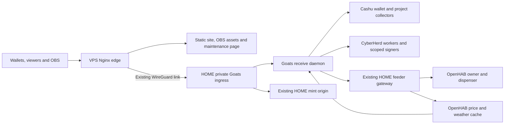

# Move Lightning Goats stateful services to HOME

This is the proposed deployment sequence. The operator approves the maintenance
window, live traffic switch, and real payment or feeding checks. Start with the
[HOME agent prompt](home-stateful-agent-prompt.md) and the
[VPS agent prompt](vps-edge-agent-prompt.md).

## Target layout

Public DNS, TLS, the website and OBS static files, WAF, rate limits, and
external availability monitoring stay on the VPS. The existing mint public
hostname and its public-to-HOME origin path stay in service. Preserve public
Lightning Addresses, NIP-05, Nostr identity, asset URLs and the payment policy.
Black Metal Buddha remains outside this move.

HOME already operates the mint, reserve, gateway, OpenHAB, and weather source.
Move the receive daemon and its ledger, Cashu wallet and signer, project invoice
and proof collectors, operator delivery, member publication and reclaim, and
CyberHerd membership, payout, and signer roles as one stateful deployment.
Inventory the actual active services, sockets, timers, helpers, and state
directories before finalizing the unit list. Move the authoritative price
cache writer with the ledger. The VPS serves the public cache endpoint through
the HOME ingress so OBS and the ledger use the same OpenHAB observation.
Preserve the existing weather and price freshness rules.

Keep separate runtime identities and local Unix sockets on HOME. Preserve peer
UID/GID checks and purpose-scoped credentials. Re-provision host-bound
credentials on HOME and check the expected public identity or scoped access.
Keep the existing physical owner, mint keysets, reserve, and their journals in
place. Bind Goats ingress to the private WireGuard interface, restrict it to the
VPS peer, and preserve independent operator access. The VPS reaches only the
reviewed HTTP routes, including signed operator routes already public. Databases,
wallet control, private signer/collector interfaces, OpenHAB REST, and unrelated
LAN services stay private.

HOME and the WireGuard path become dependencies for all dynamic Goats traffic.
Verify usable uplink and outage detection before cutover. Keep the VPS static
maintenance view useful during an outage, with a visible connection or
availability state and payment controls disabled. A payment request whose
outcome is uncertain remains subject to reconciliation. A successful static
response is insufficient evidence that HOME is healthy.

## Preserve route contracts

Inventory the effective Nginx routing on both hosts. Produce a reviewed mapping
of public host, path, methods, upstream, authentication, body limits, timeout,
logging, and outage behavior. Compare against the currently served configuration,
which can differ from the examples. Start with the repository's
[production](../../deploy/nginx/lightning-goats-production.conf.example),
[Cashu](../../deploy/nginx/lightning-goats-cashu.conf.example), and
[contact](../../deploy/nginx/lightning-goats-contact.conf.example) snippets.

| Surface | Requirements |
| --- | --- |
| LNURL discovery and callbacks, zaps, checkout | Keep the six configured addresses and shared herd pool, canonical HTTPS URLs, invoice amounts, purpose binding and provider verification. Preserve existing callback bytes, authentication and retry semantics. |
| Cashu request, intake and status, paid contact | Retain exact method, size, origin, and authentication rules. Preserve idempotency, the 100-sat contact fee, and separation from feed credit. Keep secrets, tokens, and receipt request bodies out of edge logs. |
| Status, overlay data, WebSocket | Proxy the HOME ledger and display cache with their existing freshness and cache policy. Preserve WebSocket upgrades, heartbeat timeout, resume, and snapshot behavior. Check both QRs, locked target, remainder, funded queue, and pending physical confirmation separately. |
| CyberHerd and signed operator routes | Preserve public reads and the exact already-published signed endpoints. Verify request binding and access denial from an unauthorized identity. |
| Mint hostname | Keep the existing public origin, private client scopes, and reserve/collector client bindings. Verify the mint route independently before and after the Goats upstream switch. |
| Retired routes and outage handling | Preserve existing denies, including retired LNbits and Strike paths. Use a clear unavailable response when HOME cannot be reached. Disable proxy retries for payment and other mutation routes, and preserve original identifiers for reconciliation after lost responses. |

## 1. Establish the baseline

- Pin the running VPS source and artifact hashes, configs, units/drop-ins,
  activation paths, host-specific firewall and egress policies, state locations,
  and current public route behavior. Inventory mutable stores including core,
  wallet and all CDK namespaces, both signer roles, membership, payout, project
  collector, delivery outbox, and any pending membership publication or reclaim.
- Record current cycle ID and locked rate/target, credit and funded queue,
  unresolved feeder UUIDs, issued invoices and pending receipts, custody and
  payout work, replay cursors, and signed-but-unacknowledged events. Keep raw
  evidence in protected storage and share only redacted IDs and counts.
- Agree on a tested admin recovery path, staging endpoint and temporary writer
  isolation, monitoring, maintenance window, expected outage, and named operator
  authority to advance the phases. Export otherwise ephemeral status evidence
  before stopping services.
- Select the currently deployed compatible runtime release for the move. Keep
  schema, credential policy, feed limits, and payment semantics stable through
  relocation. Resolve any actual release or platform compatibility issue during
  rehearsal.

## 2. Rehearse on HOME and at the edge

1. Install a candidate in separate state directories with independent identities
   or equivalent isolation. Use synthetic data for write tests. Keep production
   units and their socket/timer activation fenced on the destination until cutover
   and keep physical and external financial effects disabled in rehearsals.
2. Exercise the candidate using the real WireGuard path through a private or
   access-controlled VPS test vhost. Test route and method parity, proxy headers,
   denied paths, Cashu WAF handling, canonical URLs, and socket reconnect. Test
   HOME unreachable and a reconnect after upstream restart. A timeout on a
   mutating request must preserve the checkout, receipt, or request identity.
3. Rehearse a coordinated checkpoint and restore using the appropriate native
   verifier for the selected source schema. Inventory supplemental stores
   outside the standard collector bundle and verify ownership, UID/GID bindings,
   disk and sparse-file overhead, encryption, checksums, and the operator's
   ability to decrypt an off-HOME copy. Inspect real-state copies only in a
   protected, fenced environment. A verified collection establishes the
   checkpoint. Reconcile external effects separately before granting resumption.
4. Rehearse switching the edge back before writes and recovering after a
   simulated HOME write. Exercise pending funding, a lost feeder acknowledgement
   and a retry of the same UUID. Confirm both hosts can be fenced independently.

Use the [coordinated Cashu collector](cashu-backup-collection.md#coordinated-collection),
[recovery inventory](cashu-recovery-inventory.md), and
[installation rehearsal](../../deploy/scripts/rehearse-install.py).
The Cashu wallet and ledger need a coordinated checkpoint. Seed recovery
and an ordinary four-journal snapshot are insufficient for this move.

## 3. Cut over in the approved maintenance window

1. **VPS closes new admission.** Keep the static site available. Refuse new
   Goats invoice, checkout, receipt, contact, and mutation admission at the
   edge. Preserve existing public mint availability and original invoice/receipt
   identities. Payments or external effects may still occur on previously
   issued requests. Record the stop boundary and reconcile against original
   mint, relay, collector, and gateway records.
2. **VPS fences every writer.** Hold physical dispatch with the existing
   override. Drain or reconcile pending/unknown requests with the original
   UUID. Stop and fence the inventoried units and all socket/timer/helper
   activators on the VPS. Verify no process can write or still holds a writer
   lock. Keep the existing lock files with their journals.
   Take the fresh coordinated checkpoint and supplemental copies. Verify
   the checkpoint and a separately stored encrypted copy before transfer.
3. **HOME stages the accepted state.** Import into protected destinations
   using existing recovery fences, verify hashes, schema and state against the
   checkpoint, and validate the current credential and peer bindings. Review
   any interval between snapshot and activation against original IDs.
   Reconfirm the VPS fence before changing HOME write authority.
4. **Operator selects HOME as the sole writer.** Bring up HOME services in
   dependency order using the reviewed unit/socket list, while the VPS edge
   still holds public mutation admission and the feeder override still holds
   dispatch. Keep the source journals and original rollback config protected.
   Verify HOME health, inventory and reconciliation, then switch the VPS
   Goats route map to HOME with a validated Nginx reload.
5. **Operator opens traffic and verifies.** Reopen Goats admission and
   independently select when to release the feeder override. Verify a real
   operator-approved contribution against one receipt/credit, the market
   observation after a refresh, and a genuine or approved completion against
   one confirmed physical UUID and one exact debit. Validate the following
   cycle's integer ceiling independently. Check the website, OBS reconnect and
   both QRs, Nostr publication, and eligible payout and contact paths. Group
   fixture-only checks separately from observed live evidence.

Use [cross-host accounting](../../deploy/scripts/verify-cross-host-accounting.py),
[cycle accounting](../../deploy/scripts/verify-feeding-cycles.py), the
[USD-cycle runbook](usd-feeding-cycles.md#live-acceptance), and the
[mint boundary cutover notes](mint-payment-boundary-cutover.md). Track amounts
gross, fee, net, credited sats and payout proceeds separately. Look up the
original operation after a lost response before paying or dispatching again.

## Rollback, fallback and closeout

- **Before HOME writes** retain or restore the original edge route mapping
  and re-enable the VPS only after confirming HOME is fenced. Reconcile
  external settlements and other effects since the checkpoint.
- **After HOME writes** stop new admission and fence HOME. Keep public
  maintenance available. Prefer fixing or recovering HOME in place. To move
  back, take and verify a fresh coordinated HOME checkpoint, preserve receipts
  and all signed/physical history, reconcile with originals, and stage the
  current images on the VPS behind its recovery fence. Verify one writer
  before switching routes or admitting traffic. The pre-cutover VPS images
  remain historical evidence.
- During a HOME or tunnel outage retain the static edge site and alert the
  operator. Keep automatic financial or physical failover disabled.
- Record the sole-writer switch time, verified artifacts, checkpoint IDs,
  public smoke results and redacted live evidence. Keep staged rollback
  artifacts and independently recoverable encrypted backups through an
  operator-reviewed observation period. Retire the old VPS Goats units and
  excess local artifacts only after that review. Review any VPS resize separately.
